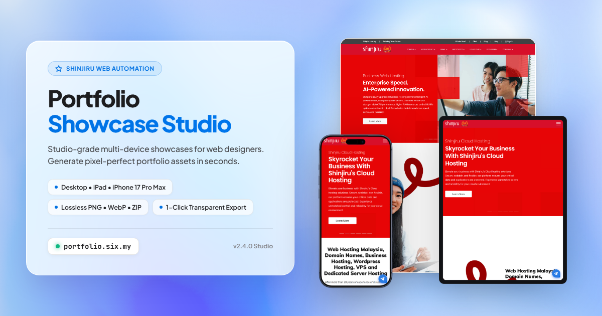

<p align="center">
  
</p>

# Portfolio Showcase Studio — Multi-Device Asset Pipeline

<p align="center">
  <a href="https://portfolio.six.my"></a>
  <a href="https://portfolio.six.my/guide"></a>
  
  
</p>

> Fully automated website portfolio showcase generator delivering studio-grade multi-device compositions (Desktop, iPad, and iPhone 17 Pro Max) with realistic 3D elevation drop shadows. Exports to WebP, PNG, JPG, and bundled ZIP packages.

---

## Key Features

1. **One-Link Full Automation**: Provide any live website URL. The stealth browser engine automatically captures the extended natural desktop viewport, responsive smartphone viewport, and tablet viewport with automated cookie banner and splash gate dismissal.
2. **High-Resolution Device Framing**:
   - **iPhone 17 Pro Max**: Precision titanium chassis in 4 finishes (Deep Blue, Natural Titanium, Black, White) with true screen curvature and Dynamic Island.
   - **iPad Tablet**: Modern minimal-bezel frame in Space Black or Silver finishes.
   - **Extended Desktop**: 5:6 vertical hero card preserving natural page layout without stretching or horizontal cropping.
3. **Agency 3D Multi-Device Composition**:
   - Elevated desktop canvas in the background with subtle perimeter stroke.
   - Smartphone positioned bottom-left overhanging the baseline.
   - Tablet positioned bottom-right overhanging the baseline.
   - Dual-tier elevation contact and ambient drop shadows.
   - 1-Click Transparent PNG mode or standard `#E5E5E5` canvas background.
4. **Smart Modal & Splash Gate Dismissal**:
   - Automated bypass of cookie consent banners (OneTrust, Cookiebot, etc.), commercial promotional dialogs, and Elementor "Enter Site" / intro splash screens.
5. **Portfolio Taxonomy & Metadata**:
   - Industry category classification (22 options matching standard agency taxonomy).
   - Website type designation (`Business`, `E-commerce`).
   - Automated export of `{project}-metadata.json` for automated CMS ingestion and listing.
6. **Multi-Format High-Resolution Exports**:
   - **WebP**: 95% quality web-optimized standard.
   - **PNG**: Lossless alpha channel transparency.
   - **JPG**: Universal 95% quality RGB.
   - Individual device captures + bundled ZIP package.
7. **Production UI Experience**:
   - **Apple Liquid Glass Interface**: Authentic macOS Light and Dark grain gradient themes compliant with WCAG AAA/AA standards.
   - **Official User Guide & Documentation**: Built-in interactive PDF viewer at `/guide`.
   - **Role-Based Access**: Multi-tier authentication with instant 1-Click Guest access.

---

## Quick Start

### 1. Web Application

To run locally:

```bash
python server.py
```

Then visit `http://localhost:8000`.

### 2. Command Line Interface (CLI)

```bash
# Basic run with default settings
python cli.py https://example.com

# Specifying custom title, category, type, and output directory
python cli.py https://example.com --name "Example Site" --category "Technology & Apps" --type "Business" -o ./exports
```

---

## Docker & VPS Deployment

The project is packaged for deployment behind an Nginx reverse proxy (such as on `portfolio.six.my`):

```bash
# Build and start container
docker-compose up -d --build
```

Nginx configuration and deployment script (`deploy.sh`) are included in the repository.

---

## Project Structure

```
├── core/
│   ├── capture.py        # Stealth browser capture engine & viewport scaling
│   ├── framer.py         # Precision device framing & screen mapping
│   ├── compositor.py     # 3D multi-device layout & elevation shadows
│   ├── exporter.py       # Multi-format exports (WebP, PNG, JPG, ZIP, JSON)
│   └── pipeline.py       # Orchestration pipeline
├── static/
│   ├── css/style.css     # Light & Dark theme tokens, layout, pagination
│   └── js/app.js         # Theme toggle, live search, pagination, API integration
├── templates/
│   └── index.html        # Clean semantic web interface
├── server.py             # FastAPI backend with static file serving
├── cli.py                # Command-line interface
├── Dockerfile            # Container configuration with Playwright dependencies
├── docker-compose.yml    # Container orchestration
└── nginx.conf            # Virtual host configuration
```
